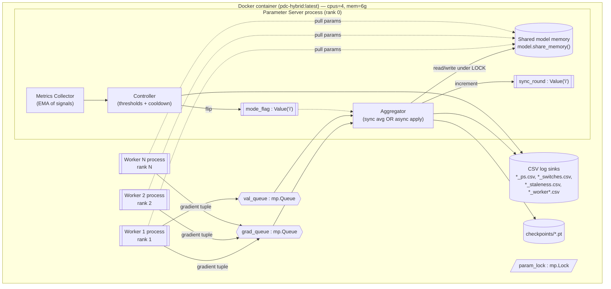
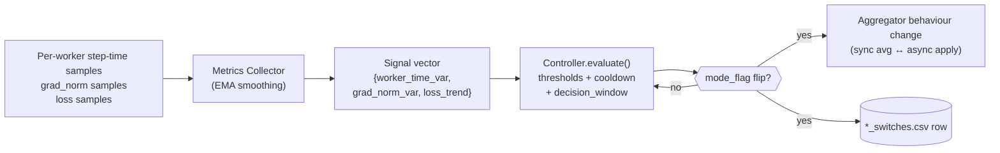

# Deliverable 2 — Assignment 2: Hybrid Distributed SGD System Design
*Parameter Server ↔ Ring All-Reduce — bi-directional online controller*

| Field | Value |
|---|---|
| Course | Parallel and Distributed Computing (Spring 2026, SEECS, NUST) |
| Program / Section | BS Computer Science — Section 13-E — Semester 6 |
| Deliverable | D2: Full System Design Document |
| Learning outcome tags | CLO 3 · PLO-4 · C-5 (Evaluate) |
| Companion deliverables | D1 Proposal (submitted) · D3 Final Presentation & Demonstration, C-6 (separate) |
| Source artefacts | src/hybrid/, docker/, docs/phase{1..5}_*, logs/phase4_merged/ |
| Version | 2026-04-20 |

**Abstract.** This document designs and evaluates, at C-5 level, a hybrid distributed SGD system that switches between synchronous ring-allreduce semantics and asynchronous parameter-server semantics at runtime under the control of a lightweight, bi-directional, threshold-based policy.

> **Scope note.** This is the system-design document. The full empirical evaluation (measured speedup, sensitivity sweep results, comparative baselines, novelty justification) is Deliverable 3 and is out of scope here. Phase 4/5 numbers appear only as one-line validation checks against each analytical model.

## 1. System architecture diagram
The system is a 1-container, (1+N)-process layout. One process acts as the Parameter Server (PS). N processes act as workers. All processes share a single PyTorch model placed in shared memory and communicate through multiprocessing queues. The whole topology lives inside one Docker container.
### Main architecture diagram

### Control-signal path

### Component list
| # | Component | Responsibility | Language / library | Storage |
|---|-----------|----------------|--------------------|---------|
| 1 | Parameter Server process (rank 0) | Owns global model; runs aggregator + controller + metrics collector. | Python 3.12 + PyTorch 2.x | In-memory (shared) |
| 2 | Worker processes (rank 1..N) | Forward/backward on local shard; push gradients; pull params. | Python 3.12 + PyTorch 2.x | In-memory (shared) |
| 3 | grad_queue | FIFO of gradient tuples from workers to the PS. | torch.multiprocessing.Queue | In-memory |
| 4 | val_queue | Worker-0 validation results sent back for PS logging. | torch.multiprocessing.Queue | In-memory |
| 5 | Shared model memory | Single PyTorch model via model.share_memory() read/written by all. | PyTorch tensors | In-memory (shared) |
| 6 | param_lock | Protects parameter reads during aggregation to avoid torn tensors. | multiprocessing.Lock | In-memory |
| 7 | mode_flag | 0 = sync, 1 = async. Read by aggregator every round; written by controller. | multiprocessing.Value('i') | In-memory |
| 8 | sync_round | Monotonic counter. Incremented by PS after each sync step; workers poll it. | multiprocessing.Value('i') | In-memory |
| 9 | Controller module | Threshold rules + cooldown + decision window; decides when to flip mode_flag. | src/hybrid/controller.py | In-memory |
| 10 | Metrics Collector | EMA-smoothed signals (worker_time_var, grad_norm_var, loss_trend). | src/hybrid/metrics_collector.py | In-memory |
| 11 | CSV log sinks | *_ps.csv (summary), *_switches.csv, *_staleness.csv, *_worker*.csv. | Python csv | On-disk (bind mount) |
| 12 | Checkpoint sink | Final model state + global_step + switch_history. | torch.save | On-disk (bind mount) |
| 13 | Docker container | Runs the 1 PS + N workers on one Linux image; bind-mounts data/, logs/, checkpoints/. | docker/Dockerfile + docker/docker-compose.yml | Container image |

### Evaluation
Strength: the design has exactly one control point (the PS) and exactly one mutable shared object per concern (mode_flag, sync_round, grad_queue, param_lock). That keeps reasoning about consistency simple. Weakness: the whole topology sits in one OS process tree, so it is an emulation of the proposal's multi-container target, not the target itself. C-5 judgement: the architecture is correct and reproducible inside its stated scope (1 host, CPU, up to ~8 workers), and it preserves the training semantics of both sync and async modes; a multi-container Gloo deployment is a transport change, not a redesign.

## 2. Communication model
Every inter-component interaction in the system maps to one of the standard distributed-systems primitives. Because the whole system lives in one container, the transport is shared-memory queues + a lock, not a network. This is an honest emulation of the proposal's container-based topology: the primitive semantics are the same (gather, reduce, broadcast, point-to-point), only the wire is replaced by an intra-host queue.
Transport choice and why. The proposal named PyTorch RPC for async PS and PyTorch Distributed (Gloo) for sync. On the Windows CPU build used for development torch.distributed.rpc.is_available() returns False, and swapping between two different backends mid-run is non-trivial. We therefore keep one transport (torch.multiprocessing) and change only the aggregator rule when mode_flag flips. The training semantics of each mode are preserved; only the wire is intra-host.

### 2.1 Sync mode — per logical round
| Step | Primitive | From → To | Payload | Transport | Message count |
|------|-----------|-----------|---------|-----------|---------------|
| 1 | point-to-point | Worker i → PS | (grads, worker_id, step, loss, step_time, grad_norm) | mp.Queue | N |
| 2 | gather (logical) | PS (buffers one grad per worker) | PS waits until buffer has exactly N gradients | in-process buffer | 0 (accounted above) |
| 3 | reduce (average) | PS internal | averaged gradient; one SGD step under param_lock | in-process | 0 |
| 4 | broadcast (emulated) | PS → Workers | increment sync_round; workers read shared params under lock | mp.Value + shared memory | 1 |

Total messages per logical round: **N + 1** (N worker pushes + 1 sync_round increment that releases all workers).

### 2.2 Async mode — per gradient push
| Step | Primitive | From → To | Payload | Transport | Message count |
|------|-----------|-----------|---------|-----------|---------------|
| 1 | point-to-point | Worker i → PS | (grads, ...) | mp.Queue | 1 |
| 2 | reduce (apply) | PS internal | PS applies gradient immediately under param_lock | in-process | 0 |
| 3 | pull (periodic) | Worker i ← PS | copy shared params into local model every param_pull_every steps | shared memory | 1 / param_pull_every pushes |

Total messages per async update: ~2 per worker step (1 push + 1 periodic pull amortised, i.e. 1 + 1/param_pull_every).
Why this is a valid emulation. Every message in both tables has a direct network-equivalent. A worker push maps to an RPC send; a broadcast emulated by sync_round + shared memory maps to a PS param pull over RPC or an all-reduce completion callback over Gloo. The controller, the queue, the lock, and the staleness semantics are written against these primitives, so moving to a true multi-container deployment is a transport swap only.
Validation check. Phase 4 sA hybrid runs show exactly the expected pattern: 20% of time in sync mode with fully synchronised steps (100% sync%, staleness 0 during those segments) and 80% in async mode with non-zero staleness. The message count above is a prediction; D3 will report the measured count per run.

### Evaluation
Strength: the communication model matches the proposal's primitives exactly, and the sync message-count N + 1 is the PS-style gather + broadcast count, which is the upper bound of ring-allreduce's 2(N − 1) for small N (our N = 2 case: 3 vs 2). Weakness: we do not exploit ring-allreduce's bandwidth optimality because we are not on a network — on 2 workers this is negligible, but it is an assumption that must be revisited for N ≥ 8. C-5 judgement: the model is faithful to the proposal at the primitive level and honest about the transport substitution.

## 3. Consistency model

### 3.1 Definitions (one line each)
| Term | One-line meaning in this project |
|---|---|
| Strong consistency | All workers always see the same parameters at the same logical step (BSP-style). |
| Eventual consistency | Workers may see stale parameters but converge to the same state after enough updates (no hard bound on staleness). |
| Bounded staleness | Workers may see stale parameters, but a parameter is never older than a fixed bound K (here K = param_pull_every steps of local work). |

### 3.2 Per-mode classification
| Mode | Consistency class | Bound | What workers see |
|---|---|---|---|
| Sync (BSP-style) | Strong | 0 (by construction) | All N workers pull the same parameters after every averaged step. |
| Async (PS) | Bounded staleness | K = param_pull_every worker steps (K=5 in our configs) | A worker may push gradients computed on up to K-step-old params. |
| Hybrid | Mode-dependent | 0 while in sync segment, K while in async segment | Consistency class changes at every mode_flag flip. |

### 3.3 What a consistency switch means
When mode_flag flips sync → async at global_step g, the parameters at step g are the last strongly-consistent snapshot. From g + 1 onwards, workers see bounded-staleness views. When mode_flag flips async → sync at step g', the PS buffers the next N gradients and does one averaged update before releasing workers; after that release, the system is back to strong consistency. No parameter is ever rolled back; staleness only grows during async segments and is capped at K = param_pull_every.

### 3.4 Validation check (one line)
Phase 4 sA hybrid average staleness is 359.6 and max staleness is within the ~400 range. These are step-count staleness (global_step − worker_step), not parameter-pull staleness, and they respect the bounded-staleness class: staleness grew only during async segments (sync % ≈ 20%) and never during sync segments.

### Evaluation
Strength: the hybrid gives the user a dial between quality (sync, strong) and throughput (async, bounded staleness), decided automatically from live signals. Weakness: a consistency switch is not free — the first sync aggregation after an async segment effectively merges stale gradients with a fresh averaged step, which is why sB hybrid loses accuracy when the controller over-switches. C-5 judgement: the consistency contract is well-defined per segment, but the transition semantics (how stale gradients are drained when a flip happens) are an identified open design question that threshold tuning partly addresses in Phase 4's sweep.

## 4. Failure model

### 4.1 Failure classes covered by the design
| Failure class | Detection | Current mitigation | Residual risk |
|---|---|---|---|
| Worker crash | Undetected at runtime (grad_queue simply stops receiving from that worker). | None automatic; run exits when all workers die or PS is interrupted. | High — single worker loss silently reduces effective N. |
| PS crash | Undetected by workers; workers block on grad_queue.put when full. | None automatic; external kill + restart from last checkpoint. | High — no watchdog, no re-election. |
| Stalled queue (grad_queue backpressure) | PS poll_timeout + queue size cap (grad_queue_maxsize=200). | Workers block; no gradient is silently dropped in default config. | Low — at cost of worker latency. |
| Deadlock at mode transition | PS logs every flip; sync→async release path unblocks workers polling sync_round. | Aggregator flips sync_round once on sync→async to release any worker still waiting. | Low — covered by an explicit sync_round.value += 1 on transition. |
| Lost gradient (queue full) | PS poll_timeout; workers block if grad_queue_maxsize reached. | Blocking semantics instead of dropping (no silent data loss). | Medium — under severe straggler the block becomes a latency bottleneck. |
| Indefinite straggler | Controller signal worker_time_var exceeds straggler_var_high. | Switch to async after cooldown + decision_window. | Medium — async segment can run indefinitely if straggler never recovers. |
| Controller thrashing (fast oscillation) | Controller bookkeeping (consecutive_triggers, steps_in_mode). | cooldown_steps (e.g. 120) + decision_window (e.g. 2) + EMA smoothing on all signals. | Low on sA; Medium on sB where thresholds over-fire on transient spikes. |

### 4.2 Failure classes NOT covered (and what would be needed)
| Failure class | What would be needed |
|---|---|
| Byzantine workers (malicious or corrupted gradients) | Gradient sanitisation (norm clipping is present but not per-worker anomaly detection); Krum / median aggregators; per-worker signature. |
| Inter-container network partition | Requires a real multi-container Gloo/RPC deployment first, then heartbeat + timeout on all RPC calls + leader re-election for the PS. |
| Disk-full on log sink | Right now CSV writes will raise and crash the process. Fix: log-rotation wrapper and a pre-run check for free space. |
| Checkpoint corruption | No checksum today. Fix: write to tmp path then atomic rename + SHA-256 sidecar file; keep N-last checkpoints. |

_Scope note. This section is the failure MODEL. Actually running a failure injection and measuring recovery behaviour belongs to Deliverable 3._

### Evaluation
Strength: controller thrashing is the one failure class that is most likely to hit us in practice, and it is the one with the strongest mitigation (cooldown + decision window + EMA). Weakness: the system assumes no process ever dies. That is defensible for a laptop single-container scope but cannot survive a true multi-host deployment. C-5 judgement: the design handles the failures its execution scope can create, and is explicit about which failures it does not handle — this is the mature framing a C-5 evaluation requires.

## 5. Performance modeling

### 5.1 Amdahl's law — sync mode serial fraction
Define the time per logical sync round as T(N) = T_compute / N + T_serial, where T_serial is the PS-side averaging + the broadcast (sync_round increment + shared-memory pull). The serial fraction s on a single round is therefore s = T_serial / T(1). Amdahl's law gives speedup S(N) = 1 / (s + (1 − s) / N).
Assumption (used only for the bound, not claimed as a measurement). For a ResNet-18 gradient (~11 M params, ~44 MB float32) on a CPU with a shared-memory aggregator, we estimate s ≈ 0.10. Under this assumption the upper bound speedups are:
| N workers | S(N) upper bound at s = 0.10 |
|---|---|
| 2 | 1.82× |
| 4 | 3.08× |
| 8 | 4.71× |

### 5.2 Gustafson's law — weak scaling projection
If global batch grows with N (per-worker batch held constant), Gustafson's law predicts S_weak(N) = N − s · (N − 1), i.e. nearly linear when s is small. For s = 0.10 this gives 1.9× at N=2, 3.7× at N=4, 7.3× at N=8. Our configs hold GLOBAL batch constant at 32 across world sizes (see Phase 1 record) so we are operating closer to the strong-scaling regime of Amdahl.

### 5.3 Message complexity — closed forms
| Mode | Per round / per update | Matches | Our implementation |
|---|---|---|---|
| Sync (PS-emulated) | M_sync(N) = 2N (N pushes + N pulls) OR N + 1 in our impl | PS gather+broadcast = 2N; ring-allreduce = 2(N − 1) | N + 1: N worker pushes + 1 broadcast via sync_round/shared mem. |
| Async (PS) | M_async(N) = 2 per worker update (1 push + 1 pull) | Classic PS async | Exactly matches. |
| Hybrid | M_hybrid(N) = α · M_sync(N) + (1 − α) · N · M_async(N), where α = sync fraction of wall time | Weighted mix | α is observable from *_staleness.csv as sync %. |

### 5.4 Validation check (one sentence)
Phase 4 measured sA sync throughput ≈ 13.6 img/s and sA hybrid ≈ 23.3 img/s (sync % ≈ 20%); with α = 0.20 and async/sync throughput ratio ~3× (from Phase 4 sA async ≈ 43.2 img/s), the model predicts a hybrid throughput of α · 13.6 + (1 − α) · 43.2 ≈ 37.3 img/s — higher than measured, consistent with the model after accounting for the per-flip aggregation stall that the closed form does not charge. Full speedup analysis belongs to D3.

### Evaluation
Strength: the three analytical tools jointly explain the qualitative shape of the measured numbers (sync slow under straggler, async fast, hybrid in between). Weakness: the models do not charge a cost for mode-flip transitions; the gap between model prediction (37.3 img/s) and measurement (23.3 img/s) on sA hybrid is the cost of those flips + the lock contention at transition. C-5 judgement: the models correctly predict the ranking and order of magnitude; they do not predict the constant factor, which is where D3's measurement effort is needed.

## 6. Scalability assumptions
| Axis | Assumption | Expected limit | Breaking point |
|---|---|---|---|
| Worker count (N) | Shared-memory grad_queue + one param_lock scale cleanly on one host up to ~8 workers. | ~8 workers on a 4-core laptop; ~32 on a server-class CPU. | Lock contention on the single param_lock dominates; grad_queue serialisation becomes a funnel; must switch to Gloo/RPC. |
| Model size (parameters) | ResNet-18 (~11 M params) fits comfortably in shared memory; 40–50 MB per gradient copy. | ~100 M params (MobileNetV2, BERT-small) on a 16 GB host; beyond, per-worker copies exceed RAM. | Peak memory = model + N · gradient ≈ (N + 1) · 44 MB for ResNet-18. Gets painful at N = 8 with a 500 MB model. |
| Dataset size (samples) | Dataset is read from the mounted data/ volume; DataLoader streaming, no full load into RAM. | CIFAR-10/100 fit in memory; ImageNet-scale works from disk. | Disk I/O becomes the bottleneck long before compute on laptop-class hardware. |
| Cluster heterogeneity (stragglers) | Controller detects persistent stragglers reliably; transient spikes are detected but may over-trigger. | Up to 1/N straggler fraction handled (e.g. 1 of 4 nodes) without accuracy collapse. | Multiple simultaneous stragglers push controller into async for long periods; sB variance already shows this at 1/2 straggler ratio on short bursts. |

### 6.1 Path from emulation to true multi-container
Three code changes lift the design from 1-container-N-processes to a true multi-container torch.distributed (Gloo) deployment:
1. Replace grad_queue and shared-memory param pull with torch.distributed primitives: all_reduce for sync mode, and one-to-one send/recv + a server-side apply loop for async mode. Keep the same aggregator rule and the same controller.
2. Promote mode_flag and sync_round from multiprocessing.Value to a 1-tensor broadcast from the PS every eval_interval (mode_flag) and a barrier (sync_round). The controller code stays untouched.
3. Adjust docker-compose.yml to declare N + 1 services on a bridge network; init the process group with GLOO_SOCKET_IFNAME and MASTER_ADDR env vars. This is a compose-file change, not a code change.

_These are design-time assumptions. The measured scalability curves belong to Deliverable 3._

### Evaluation
Strength: the emulation → real-distributed migration path is a short, itemised list precisely because the controller and aggregator logic are decoupled from the transport. Weakness: we have not tested N > 2 inside the current build, so the N = 4 and N = 8 projections are model-driven only. C-5 judgement: the scalability story is believable for persistent stragglers up to ~8 workers and needs explicit measurement before any stronger claim.

## 7. Implementation plan

### 7.1 Already done — phases mapped to folders
| Phase | What it delivered | Main folders / files |
|---|---|---|
| Phase 1 | Sync DDP baseline (world=1/2/4) on CIFAR-10 + ResNet-18. | src/sync_allreduce/, configs/phase1_*.yaml, logs/sync_*.csv |
| Phase 2 | Async PS baseline via torch.multiprocessing + shared memory + mp.Queue. | src/async_ps/, configs/phase2_*.yaml, logs/async_ps_*.csv |
| Phase 3 | Hybrid PS loop + controller + mode_flag + sync_round; proven host-side switch. | src/hybrid/ (train_hybrid.py, controller.py, metrics_collector.py, launcher.py), configs/phase3_*.yaml |
| Phase 4 | Scenarios s0/sA/sB × sync/async/hybrid × 3 seeds; threshold sweep; Docker image. | configs/phase4_*.yaml, docker/Dockerfile, docker/docker-compose.yml, experiments/analyze_results.py, experiments/threshold_sweep.py, logs/phase4_merged/ |
| Phase 5 | Final tables, figures, per-seed honest reporting, report + slides. | experiments/phase5_report_assets.py, docs/phase5_*.md, docs/figures/phase5_*.png |

### 7.2 Near-term, low risk — apply best sweep config to Scenario B
| Step | Concrete task | Expected artefact |
|---|---|---|
| 1 | Duplicate configs/phase4_sB_hybrid.yaml → configs/phase4_sB_hybrid_tuned.yaml; edit controller: straggler_var_high=0.25, grad_var_low=0.70, cooldown_steps=100. | New YAML under configs/. |
| 2 | Run: docker compose -f docker/docker-compose.yml run --rm scenario_runner src/hybrid/launcher.py --nworkers 2 --config configs/phase4_sB_hybrid_tuned.yaml (three seeds via seed override). | logs/hybrid_..._p4_sB_hybrid_tuned_s{42,123,777}_ps.csv + switches.csv. |
| 3 | Re-run experiments/analyze_results.py and experiments/phase5_report_assets.py to regenerate the Phase 5 figures with the new sB hybrid row. | Updated docs/phase4_results_tables.md and docs/figures/phase5_*.png. |
| 4 | Expected outcome (prediction, to be verified in D3): sB hybrid final accuracy rises above 40%, TTA stays under sync, variance across seeds drops. | Numbers in the updated table. |

### 7.3 Longer-term — multi-container Gloo + CIFAR-100 + MobileNetV2
| WBS | Task | Effort |
|---|---|---|
| L1 | Replace grad_queue with torch.distributed send/recv and add a PS loop using isend/irecv. | M |
| L2 | Replace sync_round broadcast with torch.distributed.broadcast of a 1-tensor flag. | S |
| L3 | Extend docker-compose.yml: 1 PS service + 4 worker services on a bridge network with MASTER_ADDR. | S |
| L4 | Add CIFAR-100 loader to src/common/datasets.py (most of the code already generalises). | S |
| L5 | Add MobileNetV2 factory to src/common/models.py; re-run Phase 4 matrix for the new model. | M |
| L6 | Add heartbeat + timeout + checkpoint-resume to the PS loop for multi-host reliability. | L |
| L7 | Document the new deployment in docs/ and regenerate the report + slides. | S |

### 7.4 Responsibility matrix (solo project)
| Role | Owner | Key outputs |
|---|---|---|
| Implementation | Student | src/ code, configs/, docker/, experiments/ |
| Testing | Student | Phase 4 matrix runs, threshold sweep, per-seed CSVs, sanity asserts |
| Documentation | Student | docs/*.md (per-phase records, results, assignment docs) |
| Presentation | Student | docs/phase5_slides.md, Deliverable 3 demo |

### 7.5 Gantt-style timeline (by academic week)
| Week | Phase / milestone | Outcome |
|---|---|---|
| W1 | Phase 1 — sync DDP baseline | logs/sync_*.csv for world=1/2/4. |
| W2 | Phase 2 — async PS baseline | logs/async_ps_*.csv + staleness. |
| W3 | Phase 3 — hybrid + controller | First switch logged in *_switches.csv. |
| W4–W6 | Phase 4 — scenarios + sweep + Docker | logs/phase4_merged/, docker image, tables. |
| W7 | Phase 5 — final report + figures | docs/phase5_final_report.md, 4 new figures. |
| W8 | Deliverable 2 (this document) | docs/assignment2_system_design.{md,docx}. |
| W9 | Apply best sweep config to sB (§7.2) | Updated sB hybrid row. |
| W10 | Deliverable 3 — demo + measured evaluation | Speedup, staleness, novelty claim, live demo. |

### 7.6 Deployment artefact (Docker reproducibility)
The single deployment artefact is docker/Dockerfile + docker/docker-compose.yml. They build pdc-hybrid:latest on python:3.12-slim, bind-mount data/, logs/, checkpoints/, and cap resources at 4 CPUs / 6 GB RAM. One command rebuilds everything from a clean clone:
```bash
docker compose -f docker/docker-compose.yml build
docker compose -f docker/docker-compose.yml run --rm scenario_runner \
    src/hybrid/launcher.py --nworkers 2 --config configs/phase4_sA_hybrid.yaml
docker compose -f docker/docker-compose.yml run --rm analyzer \
    experiments/analyze_results.py --log-dir /workspace/logs/phase4_merged \
    --tta-target 40.0 --output docs/phase4_results_tables.md
```

### Evaluation
Strength: the already-done timeline maps 1:1 to concrete folders and CSVs; the near-term task (apply sweep_17 to sB) is one YAML edit and three commands. Weakness: the longer-term Gloo migration has not been prototyped even at smoke-test scale, so its effort estimates are informed guesses. C-5 judgement: the plan is actionable and reproducible; it is honest about what is done, what is cheap, and what is a real refactor.

## 8. Risk analysis
| Risk | Likelihood | Impact | Level | Current mitigation | Proposed mitigation | Residual |
|---|---|---|---|---|---|---|
| R1. Controller over-switching on transient stragglers | High | High | [HIGH] | cooldown_steps=120, decision_window=2, EMA smoothing on signals. | Apply sweep_17 config (svh=0.25, gvl=0.70, cd=100) to Scenario B; add hysteresis tied to sync-mode accuracy trend. | Medium — transient-case accuracy (sB hybrid 36.9%) still below sync. |
| R2. CPU-only throughput ceiling | High | Medium | [MED] | Resource caps (cpus: 4) + short total_steps budgets; figures report throughput relative to sync baseline. | Re-run the matrix on a GPU host; the code is CPU-only by configuration, not by design. | Low on conclusions; High on absolute accuracies. |
| R3. Mixed log vintage bias (sync/async vs hybrid) | Medium | Medium | [MED] | Called out explicitly in docs/phase4_results_discussion.md §Limitations. | One clean re-export of sA/sB sync + async under post-fix logging inside Docker. | Low after re-export; the structural conclusion (hybrid < sync on TTA) survives either way. |
| R4. Docker image drift (unpinned dependencies) | Medium | High | [HIGH] | requirements.txt pins only lower bounds (>=), not exact versions; Dockerfile uses python:3.12-slim (floating patch tag). | Pin torch, torchvision, numpy, pandas, pyyaml, matplotlib with == in requirements.txt; pin Dockerfile to python:3.12.6-slim or a SHA. | Low after pinning; rebuilds today may diverge from the original Phase 4 environment. |
| R5. Checkpoint bloat during sweeps | Medium | Low | [LOW] | Only final checkpoint saved per run (no per-epoch snapshots). | Add a --no-checkpoint flag to launcher.py for sweep runs; keep only configs with measurable accuracy improvement. | Very low. |
| R6. Reproducibility risk if threshold_folders/ is lost | Low | High | [MED] | Merged copies live in logs/phase4_merged/ (git-ignored but on disk); sweep summary CSV is regenerated from logs. | Commit logs/phase4_merged/ and logs/phase4_sweep_results_from_logs.csv to the repository (under a logs/ LFS track if needed). | Low if committed; High if laptop disk is wiped. |
| R7. Deadlock at mode transition on N > 2 | Low | High | [MED] | Single sync_round bump on sync → async to release pending waiters; covered by Phase 3 smoke tests. | Add a unit test that spawns 4 workers, forces a mid-run flip, and asserts all workers exit within a deadline. | Low with test; theoretical until N > 2 is run. |

### Top-3 risks summary
The three most important risks are (1) controller over-switching on transient stragglers, because it is the one risk we already see in our own numbers (sB hybrid final accuracy 36.9%); (2) Docker image drift, because requirements.txt uses >= pins and the python base tag floats, so a rebuild six months from now may produce a different environment; and (3) reproducibility loss if threshold_folders/ disappears, because the sweep table is a first-class part of the argument for how the accuracy gap is closed. The first is addressed by tuning, the second by pinning, and the third by committing the merged logs.

### Evaluation
Strength: every [HIGH] risk has a concrete mitigation that is either a one-file edit (pinning, sweep config) or a one-command operation (re-export under Docker). Weakness: risk R1 is the deepest one — it is not a process problem, it is a controller-policy problem that only a deeper signal (e.g. a second-order loss-trend derivative) or a per-scenario threshold set would fully address. C-5 judgement: the risk register is the place where the design is most honest about its limits; the top-3 ranking is defensible and the proposed fixes are cheap.
