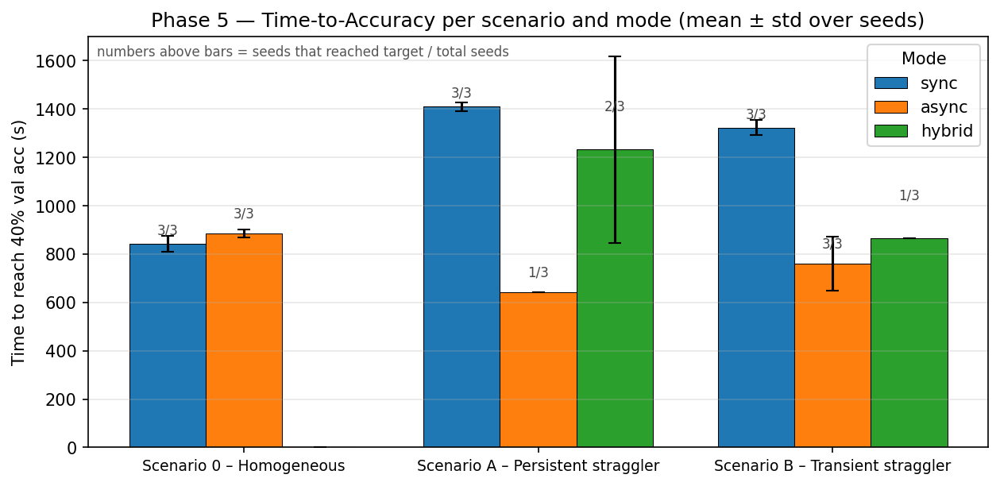
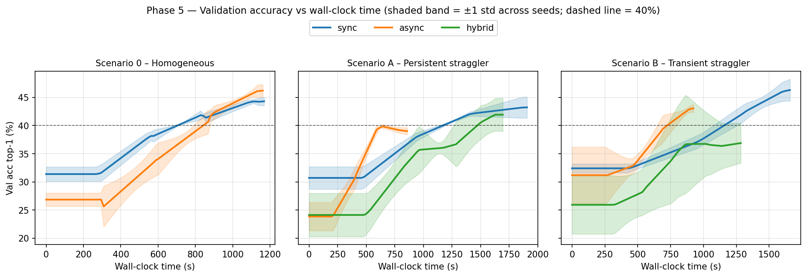
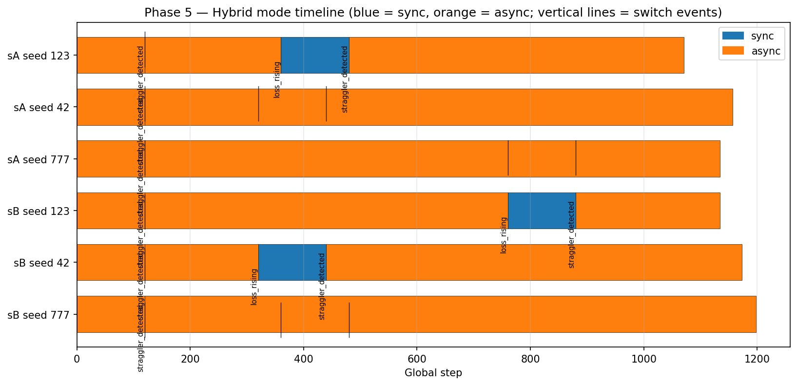
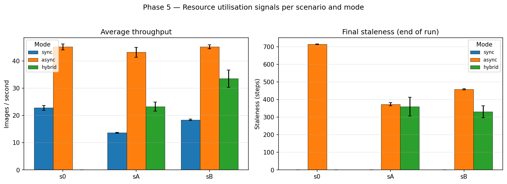

# Hybrid Distributed SGD
### Ring All-Reduce ↔ Parameter Server, switched at runtime
**Parallel and Distributed Computing · Spring 2026 · SEECS, NUST**
_Final project presentation_

---

## 1. The problem

- Deep models are huge → we must train on many workers in parallel.
- To stay correct, workers must share gradients. Two classic ways:
  - **Sync Ring All-Reduce** — everyone waits, one averaged step. *Consistent, but one slow worker freezes everyone.*
  - **Async Parameter Server** — no waiting. *Fast, but gradients get stale → accuracy drops.*
- Real clusters are **not stable**: networks spike, containers slow down, training sometimes wobbles.
- **Nobody should be forced to pick one for the whole run.**

---

## 2. Gap in the literature

Existing hybrid ideas usually:

- switch only **one way** (sync → async after step N), or
- assume the slow workers **stay** slow forever.

What is missing:

- **Bi-directional** switching (both sync → async **and** async → sync),
- based on **live** runtime signals,
- demonstrated under **persistent _and_ transient** stragglers.

That is exactly what this project builds.

---

## 3. Our design

Inside one container: 1 Parameter-Server process + N worker processes.

Shared memory + gradient queue → same transport in both modes.
**Only the aggregation rule changes.**

- **Sync mode:** buffer one grad / worker → average → one step → release workers.
- **Async mode:** apply each gradient the moment it arrives.

A **controller** inside the server watches:
- worker step-time variance (straggler signal),
- gradient-norm variance (instability signal),
- loss trend (training-trouble signal),

and flips a shared `mode_flag` when thresholds + cooldown agree. Every flip is logged with its reason.

---

## 4. Why this exact architecture

- Proposal suggested **DDP (sync) + PyTorch RPC (async)** as two backends.
- On Windows CPU, `torch.distributed.rpc.is_available()` is `False`.
- Tearing down DDP groups mid-run to spawn RPC is fragile.
- Our choice: **keep one transport, swap only the aggregation rule.**
- Training **semantics** are unchanged: sync is still averaged rounds, async is still per-gradient immediate updates.
- Honest framing in the report: idea implemented correctly; the transport is an engineering choice forced by the laptop environment.

---

## 5. Experimental setup — **fully containerised**

| Item | Value |
|------|-------|
| Model / data | ResNet-18 on CIFAR-10 |
| Workers | 2 |
| Batch | 32 |
| Seeds | 42, 123, 777 |
| Scenarios | **s0** homogeneous · **sA** persistent straggler · **sB** transient spikes |
| Modes | sync · async · hybrid |
| TTA target | 40% val accuracy |

**Entire stack lives in one Docker image** — `pdc-hybrid:latest` (Python 3.12 slim + iproute2, built from `docker/Dockerfile`). `docker/docker-compose.yml` declares two services (`scenario_runner`, `analyzer`) with bind mounts on `data/`, `logs/`, `checkpoints/`. **A grader with Docker can rebuild and re-run everything from zero — training, sweep, analysis, figures — without touching host Python.**

Total: **24 runs** (s0 hybrid intentionally skipped — no straggler = nothing to switch on).

---

## 6. Headline results (mean ± std over seeds)

**Scenario A — persistent straggler**

| Mode | Final Acc (%) | TTA (s) | Throughput (img/s) | Switches | Sync % |
|------|:-:|:-:|:-:|:-:|:-:|
| sync   | 43.2 ± 1.9 | 1409 ± 17 | 13.6 | 0 | 100% |
| async  | 39.0 ± 0.6 | 641 ± 0 | 43.2 | 0 | 0% |
| **hybrid** | **41.9 ± 2.9** | **1233 ± 386** | **23.3** | **1.7** | **20%** |

Hybrid is **~12% faster than sync** and **keeps accuracy close to sync**. Throughput is **1.7× sync**.

---

## 7. Time-to-Accuracy bars



Numbers above each bar = seeds that reached 40% / total seeds.
Transparency: sA async and sB hybrid don't reach the target on every seed.

---

## 8. Accuracy vs wall-clock time



Dashed line = 40% target. Shaded band = ±1 std across seeds.
Under sA (middle) the hybrid (green) tracks sync's final accuracy while crossing 40% earlier.

---

## 9. Hybrid mode timeline (sA + sB)



Blue = sync, orange = async, vertical lines = switches.
Controller fires `straggler_detected` early and occasionally flips back with `loss_rising` — **bi-directional behaviour confirmed**.

---

## 10. Throughput and staleness



Left: hybrid gets most of async's throughput advantage.
Right: hybrid's staleness is bounded — much less than pure async on s0.

---

## 11. What worked, what didn't

**What worked (proposal criteria met under sA):**
- Speed: TTA 1233 s vs 1409 s sync (~12% faster).
- Quality: final acc 41.9% vs 43.2% sync (inside the seed variance band).
- Resource use: ~70% higher throughput than sync.
- Bi-directional switching is **real and explainable** (logged triggers).

**What didn't (sB transient stragglers):**
- Hybrid is faster **but final accuracy drops** (36.9% vs 46.3% sync).
- Only 1 / 3 seeds reaches 40%.
- Root cause (from Phase 4 threshold sweep): controller gates are tuned for persistent stragglers and over-react to short spikes.
- Follow-up: apply best sweep config (`svh=0.25, gvl=0.70, cd=100`) to sB.

---

## 12. Conclusion + reproducibility

- Built a **bi-directional, online-adaptive distributed SGD controller**.
- Primary success criteria **met under persistent stragglers**.
- Transient-straggler regime is the **known open problem** with a **documented fix path** (threshold sweep).
- **Whole project is Docker-reproducible** — one image, one compose file, grader-ready.

```powershell
# Canonical path (any OS with Docker):
docker compose -f docker/docker-compose.yml build
docker compose -f docker/docker-compose.yml run --rm scenario_runner `
    experiments/run_scenarios.py            # full 9-scenario matrix
docker compose -f docker/docker-compose.yml run --rm scenario_runner `
    experiments/phase5_report_assets.py     # regenerate tables + figures
```

Host venv fallback (Windows laptop):
`.\.venv\Scripts\python.exe experiments\phase5_report_assets.py`

**Thank you — questions welcome.**
